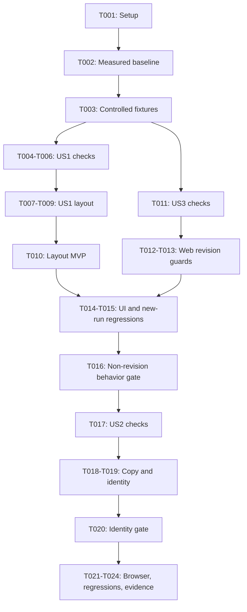

# Tasks: Workspace Visual Refresh

**Input**: Design artifacts in `specs/017-workspace-visual-refresh/`.
**Prerequisites**: [spec.md](spec.md), [plan.md](plan.md), [research.md](research.md), [data-model.md](data-model.md), [workspace contract](contracts/workspace.md), and [quickstart.md](quickstart.md).
**Tests**: Required by the specification's measurable checks and constitution. Write behavior-scoped checks before their implementation, verify the intended failing result, then rerun after each small owning edit.
**Organization**: US1 (P1) and US3 (P1) precede US2 (P2). Story numbers retain their spec identities rather than their phase order. All tasks are initially unchecked.

## Format: `[ID] [P?] [Story] Description`

- `[P]` means different-file work that may run together after documented prerequisites; it does not authorize delegation or simultaneous builds using shared outputs.
- `[US1]`: Focused Writing Workspace. `[US3]`: Preserve Non-Revision Operations. `[US2]`: Updated Workspace Identity.
- All file paths are repository-relative. Reuse existing files, test projects, stubs and live-host helpers; no new projects, packages or resource deployments are required.

## Phase 1: Setup (Shared Infrastructure)

**Purpose**: Verify the environment and protect a pre-change visual baseline.

- [X] T001 Verify .NET 10 and VSTest configuration in `BlogWriter.Web.Tests/BlogWriter.Web.Tests.csproj` and `BlogWriter.Tests/BlogWriter.Tests.csproj`, read applicable instructions and current user-edited files, restore existing dependencies, verify ignore patterns, and record setup/baseline test results in `specs/017-workspace-visual-refresh/quickstart.md`; use Release when user-owned Debug servers lock DLLs and do not stop those servers or upgrade packages.
- [X] T002 Capture the current live workspace before any Home/CSS/component edits by reusing the Kestrel fixture in `BlogWriter.Web.Tests/SessionListBrowserTests.cs`; at 1280 CSS pixels/default zoom, record query textarea border-box width, column edges, container border/padding/gap, viewport and screenshot in `specs/017-workspace-visual-refresh/quickstart.md`, preserving a baseline value or fixture for later comparison; do not substitute the CSS-derived 569.8px estimate for measured evidence (depends on T001).

## Phase 2: Foundational (Blocking Prerequisites)

**Purpose**: Make the existing test harness usable for the refreshed page without a new host or live agents.

- [X] T003 Prepare reusable controlled-session and initial-writing fixtures in `BlogWriter.Web.Tests/ListLauncherTestHelpers.cs` and the existing host helpers in `BlogWriter.Web.Tests/SessionListBrowserTests.cs`; retain early host configuration, Testing-only identity, dynamic ports, local-network test-browser flags, WebSocket/interactive-render waits and cleanup; reuse existing writing stubs where possible because the list-only service deliberately throws on StartAsync/ReviseAsync, and provide recording assertions for successful initial runs and zero revision calls without production configuration changes (depends on T002).

**Checkpoint**: Baseline is recorded and fixture helpers are ready. No application edit may precede T002. No persisted schema, authentication or shared revision-service change is introduced by setup.

## Phase 3: User Story 1 - Focused Writing Workspace (Priority: P1) - Layout MVP

**Goal**: A wider New query input, adjacent vertical word targets and a Draft area spanning the combined columns, without rendered revision/reviewer sections.

**Independent Test**: Render the workspace with controlled data, inspect DOM and real desktop geometry, and compare query width against T002 without invoking writing work.

### Tests for User Story 1

- [X] T004 [P] [US1] Add focused DOM/layout checks in `BlogWriter.Web.Tests/HomePageTests.cs` for one query input, one bound word-target group beside it, absent Revision request/Reviewer notes sections, existing List content within the single Draft area, unchanged command order/callbacks and no empty central range slot; keep query/min/max IDs and verify no duplicated or hidden focusable replacement controls (after T003).
- [X] T005 [P] [US1] Extend `BlogWriter.Web.Tests/WordRangeInputTests.cs` for Target Words/Minimum/input/Maximum/input order, removal of the horizontal `to` separator, full accessible labels, retained IDs/descriptions, existing value callbacks, validation errors and disabled rules; preserve the data-model constraint "Word targets retain current positive/ordered validation, default values, input IDs and accessible descriptions; no new numeric constraints." (after T003).
- [X] T006 [P] [US1] Add whole-workspace geometry checks in `BlogWriter.Web.Tests/SessionListBrowserTests.cs` using the live host and T002 baseline: assert query width is baseline times 1.20 within 2 pixels at 1280, Target Words is on its right, the vertical fields have equal widths/common left edges, Draft spans combined columns and command left edge matches query within 2 pixels; cover 320-pixel reflow, long content and word-limit error boxes, and capture screenshots; do not use the static SessionList-only fixture as full-page evidence (after T003).

### Implementation for User Story 1

- [X] T007 [US1] Change `BlogWriter.Web/Components/WordRangeInput.razor` to render the vertical Target Words group with full Minimum/Maximum labels and no separator, retaining values, callbacks, validation associations and enabled/disabled behavior; update its screen-reader help wording only as needed for the full labels, and rerun T005's narrow checks immediately (depends on T005).
- [X] T008 [US1] Update `BlogWriter.Web/Components/Pages/Home.razor` to remove the Revision request input and ReviewPane invocation, move the existing bound WordRangeInput into the query row and retain both Draft/List branches; update `BlogWriter.Web/Components/CommandBar.razor` to omit the central range slot only when optional ChildContent is absent while preserving its parameter, command order and callbacks; retain ReviewPane source/internal data and rerun the focused T004 checks (depends on T004 and T007).
- [X] T009 [US1] Change the relevant layout rules in `BlogWriter.Web/wwwroot/app.css` to desktop query/target tracks `minmax(0, 1.2fr)` and `minmax(0, .8fr)` with existing strip gap/padding, one full-span Draft column and matching column-edge insets for Draft/commands; use one-column mobile reflow, remove obsolete empty-slot positioning and preserve scroll limits/type/color/focus treatments; enforce "Desktop query border-box width equals captured baseline times 1.20 within 2 pixels. Draft spans both columns; command left edge aligns to query. Layout measurements are not session data." and rerun T006 immediately (depends on T006-T008).
- [X] T010 [US1] Run the scoped US1 component/range/browser checks for `BlogWriter.Web.Tests/BlogWriter.Web.Tests.csproj`, inspect baseline/final desktop and narrow screenshots and measured boxes, then build `BlogWriter.Web/BlogWriter.Web.csproj` in Release; record FR-002 through FR-006, FR-009 and layout evidence in `specs/017-workspace-visual-refresh/quickstart.md` (depends on T004-T009; old revision tests are intentionally reconciled in US3 rather than skipped).

**Checkpoint**: US1 layout is independently demonstrable. Do not claim full feature completion until the authorized revision capability is actually blocked in US3.

## Phase 4: User Story 3 - Preserve Non-Revision Operations (Priority: P1)

**Goal**: Remove every user-initiated web revision submission path while retaining initial writing, state guards, saved data and internal reviewer behavior.

**Independent Test**: Through the web service and recording stubs, complete an initial run, populate stale revision text, invoke Go/direct revision entry, and assert zero revisions; restore historical sessions and verify new initial-run submission without saved mutation.

### Tests for User Story 3

- [X] T011 [US3] Add/revise focused service/state tests in `BlogWriter.Web.Tests/BlogWorkspaceServiceTests.cs` covering Go and direct SubmitRevisionAsync with completed drafts, stale/historical RevisionPrompt, restored-pending contexts and busy/ended guards; quote and verify "Direct SubmitRevisionAsync is non-operational: no shared revision invocation, model calls, persistence writes or source mutation." and "A completed draft retains its query lock. Go in revision-latched context is a no-op even if historical revision text exists; New or restored-pending context permits initial query entry again."; check zero revision calls, initial StartAsync values, preserved saved revision/review data and unchanged query-lock/New rules before production edits (after T003; can be tested independently of US1 layout).

### Implementation and Integration for User Story 3

- [X] T012 [US3] Remove revision dispatch from `BlogWriter.Web/Services/BlogWorkspaceService.cs` SubmitAsync and make public SubmitRevisionAsync return a completed task without shared-service calls or state mutation; retain initial/restored-pending dispatch, captured word-range validation and all cancellation/output/list/restore methods, and do not automatically start another run from completed revision-latched context; rerun the corresponding T011 submission tests immediately (depends on T011).
- [X] T013 [US3] Set IsRevisionInputEnabled permanently false in `BlogWriter.Web/Services/BlogWorkspaceState.cs`, retaining the model constraints "Retained post-draft latch for query lock; cannot authorize revision submission" for IsRevisionRequested, "Existing initial-run routing after restoration, independent of historical revision text" for IsRestoredPending, and "Existing processing, stopping, listing, selecting, ended and command availability rules" for busy/state flags; preserve RevisionPrompt and Review as internal/historical fields, draft latching, accepted ranges and query lock, then rerun the T011 state checks (depends on T011-T012).
- [X] T014 [US3] Reconcile affected tests in `BlogWriter.Web.Tests/HomePageTests.cs`, `BlogWriter.Web.Tests/WorkspaceBrowserTests.cs` and `BlogWriter.Web.Tests/SessionListBrowserTests.cs`: replace removed `#revision-prompt` and review-pane assertions with DOM absence and internal/saved-data checks, replace former web revision-success tests with no-op/zero-call tests, and retain initial Go, pointer/Enter/Space restoration, disabled selection, Stop/cancel, Help, discard and ended-state coverage; do not skip tests or weaken unrelated behavior (depends on T008 and T012-T013).
- [X] T015 [US3] Validate new-query Go and historical-session restoration with controlled writing stubs through `BlogWriter.Web.Tests/BlogWorkspaceServiceTests.cs` and `BlogWriter.Web.Tests/HomePageTests.cs`, confirming current query/target values reach StartAsync, internal reviewer/log updates still accumulate, invalid bounds still prevent work, source sessions remain unchanged and completed-draft Go never submits a revision; preserve shared `IBlogWriterSessionService.cs` and core/console revision tests (depends on T012-T014).
- [X] T016 [US3] Run focused US3 tests and the existing live-browser restoration checks in `BlogWriter.Web.Tests/BlogWriter.Web.Tests.csproj`, build `BlogWriter.Web/BlogWriter.Web.csproj`, and record FR-010/SC-004 and initial-run/cancel/list/restore compatibility evidence in `specs/017-workspace-visual-refresh/quickstart.md` (depends on T011-T015).

**Checkpoint**: Web revision capability is gone, including direct and stale-restored submission. Console revision support, persistence schema and reviewer agents remain unchanged. US1 plus US3 is the functional release minimum.

## Phase 5: User Story 2 - Updated Workspace Identity (Priority: P2)

**Goal**: Requested heading and signed-in identity copy, retained Sign out, and no description or Draft index.

**Independent Test**: Inspect intro/header/Draft with controlled signed-in and unauthorized contexts; verify exact text, separate identity lines and preserved Sign out destination/action without writing work.

### Tests for User Story 2

- [X] T017 [US2] Add copy/identity checks in `BlogWriter.Web.Tests/HomePageTests.cs` and `BlogWriter.Web.Tests/WorkspaceBrowserTests.cs` for Research. Write. Revise., absent former heading/summary, Jesse Liberty above Senior AI Engineer, retained Sign out destination and authorization gating, and Draft without 01; test fixed header copy does not change claims or owner identity and prepare live 320/1280 identity-line visibility checks in the existing browser tests (after prior edits to these files finish).

### Implementation for User Story 2

- [X] T018 [P] [US2] Update the intro copy in `BlogWriter.Web/Components/Pages/Home.razor` to Research. Write. Revise. and remove the description sentence; remove only the decorative 01 span from `BlogWriter.Web/Components/DraftPane.razor`, retaining Draft label/content/empty-state semantics; rerun T017's intro/Draft checks (depends on T017).
- [X] T019 [P] [US2] Replace visible email text in `BlogWriter.Web/Components/Layout/MainLayout.razor` with Jesse Liberty and Senior AI Engineer on separate lines inside existing AuthorizeView, keep Sign out unchanged, and adjust only identity/header responsive rules in `BlogWriter.Web/wwwroot/app.css` so mobile does not hide the name/role or overlap the link; preserve the data-model rule "Fixed header copy is not identity data and must not be used for ownership, authorization or an account update." and rerun focused signed-in/unauthorized and identity-line checks (depends on T017; separate files from T018).
- [X] T020 [US2] Run the copy/header/Draft tests and live identity layout checks for `BlogWriter.Web.Tests/BlogWriter.Web.Tests.csproj`, build the web project, and record FR-001/FR-007/FR-008/SC-001 evidence including the exercised Sign out result or any unverified external sign-out effect in `specs/017-workspace-visual-refresh/quickstart.md` (depends on T017-T019).

**Checkpoint**: All requested visible changes are implemented; no account/profile or production authentication change has been introduced.

## Phase 6: Polish & Cross-Cutting Concerns

**Purpose**: Complete whole-page accessibility, regression and evidence gates without unrelated changes.

- [X] T021 Run and complete whole-workspace Chromium acceptance checks in `BlogWriter.Web.Tests/SessionListBrowserTests.cs` at 320/1280 pixels and increased text size: measure query/bounds against T002, verify vertical labels/inputs, full-span Draft and command alignment, no page overflow/overlap with long content/errors, all remaining enabled controls reachable with visible keyboard focus, no focusable removed fields, name/role/Sign out visibility, and live restoration/no-revision behavior; capture and inspect final screenshots and record SC-002/SC-003/SC-005 in `specs/017-workspace-visual-refresh/quickstart.md` (after all stories).
- [X] T022 Run complete suites for `BlogWriter.Web.Tests/BlogWriter.Web.Tests.csproj` in Release and `BlogWriter.Tests/BlogWriter.Tests.csproj`, then build `BlogWriter.Web/BlogWriter.Web.csproj` with its core dependency; confirm shared console/revision/persistence outcomes remain unchanged, record results in `specs/017-workspace-visual-refresh/quickstart.md`, and report rather than fix unrelated existing failures (depends on T021).
- [X] T023 Consolidate measured baseline/final widths and edge tolerances, inspected screenshots, actual command/sign-out/keyboard results, intentional web revision no-op contract and all test/build outcomes in `specs/017-workspace-visual-refresh/quickstart.md`, checking each against `specs/017-workspace-visual-refresh/contracts/workspace.md`; distinguish unperformed checks from passing evidence and preserve unrelated user edits (depends on T022).
- [X] T024 Perform final scope/diagnostic review of the changed web files and `specs/017-workspace-visual-refresh/tasks.md`, verify no cloud/deployment/package/identity/persisted-schema/shared-revision changes, rerun any narrowly affected checks if repaired, and mark only completed tasks while leaving `specs/017-workspace-visual-refresh/checklists/requirements.md` read-only; report genuinely blocked acceptance criteria rather than claiming them complete (depends on T023).

## Dependencies & Execution Order

### Phase Dependencies

- T001 setup precedes T002 actual baseline capture. T002 must finish before editing any affected visual surface or discarding the old measurement context.
- T003 prepares existing fixtures after baseline capture and blocks story work.
- Preferred execution order: US1 T004-T010, US3 T011-T016, US2 T017-T020, then T021-T024.
- US3 service/state tests can be defined independently of layout, but its integration reconciliation waits for the removed markup. US2's copy/header checks are independently testable, but shared Home/CSS/test edits wait for earlier edits in those files.
- US1 alone is the layout MVP, not a complete release of the clarified feature. Complete US3 before claiming removal of revision capability.
- Every owning implementation edit runs its narrow test next. Avoid simultaneous builds against the same output or edits in the same file.

### Dependency Graph



### Parallel Opportunities

- T004, T005 and T006 define checks in separate Home, range and browser files after T003. T006 is sequential with the completed T002 baseline edit in the same browser file.
- T018 and T019 can run together after T017 because intro/Draft edits and layout-header/CSS edits use different files. Run shared-output commands sequentially.
- US3 can be exercised through state/service fixtures without rendered layout, but do not run T011 edits concurrently with another task touching its tests.
- No concurrency is assumed for Home or app.css across stories. There are five `[P]` task markers, representing two bounded parallel groups.

## Parallel Example: User Story 1

```text
After T003:
T004: HomePageTests.cs DOM/wiring checks
T005: WordRangeInputTests.cs labels/validation checks
T006: SessionListBrowserTests.cs live geometry checks
Then implement T007-T009 and validate T010 in sequence.
```

## Parallel Example: User Story 3

```text
Service/state scenarios in T011 can be designed independently of layout.
Do not parallelize edits within T011 or T012-T013 validation commands;
reconcile Home and live-browser expectations only after T008 is complete.
```

## Parallel Example: User Story 2

```text
After T017:
T018: Home.razor and DraftPane.razor intro/index changes
T019: MainLayout.razor and app.css authorized identity/reflow changes
Then run T020 after both finish.
```

## Requirement Coverage

| Requirement or Outcome | Primary Tasks |
| --- | --- |
| FR-001 heading and absent summary | T017-T018, T020 |
| FR-002 removed rendered revision/reviewer sections | T004, T008, T014, T021 |
| FR-003 20% query widening | T002, T006, T009-T010, T021 |
| FR-004 vertical Target Words alignment | T005-T009, T021 |
| FR-005 Draft spans combined columns and List remains | T004, T006, T008-T010, T014-T015, T021 |
| FR-006 command order, alignment and no revisions | T004, T008-T010, T011-T016, T021 |
| FR-007 fixed display identity, Sign out and authorization | T017, T019-T020, T021 |
| FR-008 absent Draft index | T017-T018, T020 |
| FR-009 bound controls/validation/labels unchanged | T005, T007, T011, T015, T021 |
| FR-010 web revision removal and data/new-run preservation | T011-T016, T022 |
| FR-011 responsive no-overlap/no-overflow | T006, T009-T010, T019-T021 |
| SC-001 visible replacement/removal checks | T004-T005, T017-T020 |
| SC-002 measured widths and alignment | T002, T006, T009-T010, T021 |
| SC-003 responsive/error geometry | T006, T009, T019, T021 |
| SC-004 non-revision behavior and zero revision submissions | T011-T016, T020, T022 |
| SC-005 labels and remaining keyboard controls | T005, T006, T014, T021 |

## Implementation Strategy

### MVP First

1. Verify setup, capture the real pre-change baseline and prepare existing fixtures.
2. Deliver and independently validate US1's layout slice.
3. Complete US3 before considering the clarified feature release-ready; hiding the revision input alone is insufficient.

### Incremental Delivery

1. Layout and moved controls retain IDs, values and current validation.
2. Web revision entry points become no-ops while initial/restored-new-run behavior, data and automatic reviewer processing stay intact.
3. Apply copy/name/role/index changes without modifying identity records or authorization.
4. Finish actual browser/keyboard measurements and full regressions; record genuine evidence, not CSS estimates or unexecuted tests.

## Notes

- Preserve the current plan and user changes; this command generates only the task artifact.
- No new projects/packages, production auth bypass, persistence migration, cloud deployment, shared revision interface change or agent implementation edit is required.
- Read repository MAF procedures if scope unexpectedly requires MAF changes; do not silently expand beyond web workspace routing.
- Do not commit or create branches unless requested. Keep requirements-quality checklist markers distinct from task completion.
